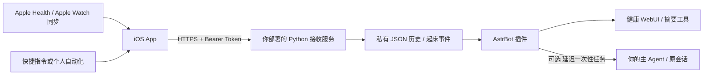

# Darkkita Health

**把 Apple Health 接入你自己的 AstrBot：iPhone 采集 → 自部署 HTTPS 接口 → 健康摘要 / WebUI → 可选起床后 AI 问候。**

[](https://github.com/Dos7t3r/darkkita-health/actions/workflows/check.yml)
[](LICENSE)

这是一个自部署、单用户项目，包含 **iOS App、App Intents 快捷指令动作、Python 接收服务、AstrBot 插件、健康历史页面和测试**。**项目不提供公共服务器、托管 API、共享 Token 或 AI 服务。所有使用者必须自行部署，并填写自己的服务器地址和账号。**

English overview: Self-hosted Apple Health → AstrBot integration, with a native iOS app and Shortcuts actions. Bring your own HTTPS server, token, AstrBot instance and LLM provider. No hosted endpoint is included. Downloadable iOS builds are unsigned and require your own signing.

## 可以做什么

- 一次授权读取健康数据，之后通过 App 或快捷指令上传。
- 每次补传服务器时区的今天及前两天，适应 Apple Watch 延迟同步；重复上传由服务端去重。
- 保存睡眠阶段、夜醒、起止时间、11 项指标与训练，按日期保留历史。
- AstrBot 提供 `get_health_summary` 工具、`/健康` 指令与健康 WebUI。
- 可选“起床并上传”：上传完成后，约 3 分钟触发主 Agent 主动问候，每个自然日只安排一次。
- 假期模式避免按星期推测上课；问候遵循使用者当前会话人格，不绑定作者的角色设定。
- 健康原始样本留在你的服务器；AI 按需读取摘要，起床问候只带紧凑摘要，不注入所有原始样本。

**支持的数据，不等于 Apple Watch 所有可记录类型。** 本版不上传 ECG 波形、运动路线、GPS、用药、月经或全部 HealthKit 数据类型。设备没有记录或使用者未授权的数据不会伪造或补零。

## 数据范围

| 类别 | 内容 / 上传单位 |
| --- | --- |
| 睡眠 | 卧床、通用睡眠、核心、深睡、REM、清醒、起止时间、来源 |
| 心率 / 静息心率 | bpm |
| HRV | SDNN，ms |
| 呼吸频率 | 次/分钟 |
| 血氧 | %，App 把 HealthKit 比例转换为 0–100 |
| 睡眠腕温 | **绝对腕温**，°C；不是健康 App 的相对基线变化，也不是核心体温 |
| 步数 | count，HealthKit 每日汇总 |
| 活动能量 | kcal，HealthKit 每日汇总 |
| 步行与跑步距离 | km，HealthKit 每日汇总 |
| 锻炼 / 站立时间 | min，HealthKit 每日汇总；站立分钟不是站立小时 |
| 训练 | 类型、开始/结束、可用的活动能量与距离；不含路线 |

## 架构与项目结构



```text
main.py / metadata.yaml     AstrBot 插件（仓库根目录可直接作为插件安装）
views/health/              健康页面
.astrbot-plugin/           页面本地化资源
server/                   独立 Python 接收服务与 Dockerfile
ios/                      SwiftUI + HealthKit + App Intents 工程
deploy/                   nginx 片段、systemd 示例
scripts/                  可复现构建和打包脚本
tests/                    合成数据、隔离服务和页面测试
docs/                     API 协议、部署说明、iOS 签名及限制
```

## 开始前

你需要：

1. 一台自己管理的服务器、自己的域名及可信 HTTPS 证书。
2. AstrBot；健康插件面向 `>=4.16,<5` API，页面及起床任务依赖插件 Web API、Plugin Views 和 `context.cron_manager`。不同版本或分支需要自行确认接口兼容性。
3. 如需 AI 问候，配置自己的模型提供商、机器人平台与可主动发消息的目标会话。
4. iPhone（最低 iOS 17）；有 Apple Watch 才有的指标必须先同步到 iPhone。
5. 构建/真机运行 App 需要 Mac、Xcode、Apple 开发签名。仓库不包含开发证书或 provisioning profile。

接收端和插件必须能访问 **同一份健康数据目录**。接收端、AstrBot 插件和 iOS App 必须填写 **同一个 IANA 时区**。默认服务器时区为 `UTC`；可统一改为 `Asia/Shanghai` 等，不要只改一端。

## 1. 部署你自己的接收服务

接收服务只使用 Python 标准库，无第三方 Python 依赖。推荐在 nginx / Caddy 等反向代理后运行。不要把 AstrBot WebUI 或数据目录直接当作公开上传接口。

### Docker Compose

```bash
git clone https://github.com/Dos7t3r/darkkita-health.git
cd darkkita-health
cp .env.example .env
# 编辑 .env，将 HEALTH_TIMEZONE 设为你使用的 IANA 时区。
mkdir -p runtime/health runtime/secrets
# 容器默认使用 UID/GID 10001。根据部署机器权限执行：
sudo chown -R 10001:10001 runtime/health runtime/secrets
sudo chmod 700 runtime/health runtime/secrets
docker compose up -d --build
curl http://127.0.0.1:8799/health/ping
```

第一次启动会在 `runtime/secrets/token` 生成随机上传 Token。**仅在本机查看并复制到 App，不要提交 Git，不要贴到 issue 或聊天。** Token 不包含在 `.env.example` 中。

端口默认只绑定服务器的 `127.0.0.1:8799`。将 [nginx 示例](deploy/nginx.conf.example) 加到你自己的 HTTPS `server` 块，使用自己的域名和证书，最终地址例如：

```text
https://health.example.com/health/ingest
```

这里的 `example.com` 只是示例，不能使用。App 不接受明文 HTTP，也不会跟随上传重定向；反向代理应直接响应准确的 `/health/ingest` 路径，避免 301/302。

### 不使用 Docker

需要 Python 3.10+ 和系统 IANA 时区数据库；建议 Python 3.12+。

```bash
export HEALTH_TIMEZONE=UTC
export HEALTH_INGEST_BASE="$PWD/runtime/secrets"
export HEALTH_DATA_ROOT="$PWD/runtime/health"
python3 server/health_ingest.py
```

长期运行可参考 [systemd 示例](deploy/health-ingest.service)，自行创建 `health` 用户、目录及权限。完整说明见 [部署文档](docs/DEPLOYMENT.md)。不要同时启动多个接收服务进程写同一个目录：当前锁是单进程锁。

## 2. 安装 AstrBot 插件，共享数据目录

可在 AstrBot 插件管理中从本仓库安装，或下载 [Releases](https://github.com/Dos7t3r/darkkita-health/releases) 的 **`astrbot_plugin_apple_health.zip`** 安装。ZIP 只包含插件代码，不含 iOS 工程、数据或服务器配置。

接收端和 AstrBot 容器可以把同一个宿主目录映射到不同的容器路径。例如给 AstrBot **增加**：

```yaml
# 添加到你现有的 AstrBot 服务，不要覆盖其现有 data 挂载。
volumes:
  - /absolute/path/darkkita-health/runtime/health:/AstrBot/data/plugin_data/astrbot_plugin_apple_health
environment:
  HEALTH_TIMEZONE: UTC
```

`/absolute/path/...` 必须换成你机器上的路径；时区也必须与接收端一致。AstrBot 运行用户需要读写这个目录：健康页读取历史，起床任务需要更新事件状态。接收端生成的记录权限为 `0600`，目录可能为 `0700`；若 AstrBot 非 root 运行，请统一两边 UID，或明确配置共享组/ACL，**不要直接 chmod 777**。

非标准目录可以给 AstrBot 设置 `HEALTH_DATA_ROOT`，同时确保映射指向同一份宿主目录。

重载插件后检查：

- 工具中注册了 `get_health_summary`。
- 上传前 `/健康` 显示没有数据，这是正常状态。
- 上传后 `/健康`、`/健康 睡眠`、`/健康 步数`、`/健康 历史` 可读取摘要。
- 插件的健康页面可查看睡眠阶段与历史日期。浏览器仅访问 AstrBot 自己的鉴权页面 API，不直接拿上传 Token。

## 3. 安装与配置 iOS App

### 用 Xcode（推荐）

1. 打开 `ios/DarkkitaHealth.xcodeproj`，选择 `DarkkitaHealth` scheme。
2. Signing & Capabilities 中选择 **你自己的 Team**，必要时把 Bundle Identifier 改成自己的唯一标识；保留 HealthKit capability。
3. 连接 iPhone、打开开发者模式，编译运行。具体权限和签名取决于自己的 Apple 账号。
4. App 中填写 **自己的 HTTPS `/health/ingest` 地址**和与服务器一致的 IANA 时区，保存服务器设置。
5. 粘贴自己的上传 Token，保存。Token 存入本机钥匙串，不包含在源码里。
6. 点击“授权读取健康数据”，在系统页选择允许的类型；然后手动“立即上传”一次。
7. 确认 App 成功，并到自己的 AstrBot `/健康` 核对实际记录。

### 下载编译产物

[Releases](https://github.com/Dos7t3r/darkkita-health/releases) 提供：

| 文件 | 用途 |
| --- | --- |
| `DarkkitaHealth-unsigned.ipa` | **未签名真机构建**；必须使用自己的证书/Team 重新签名并具备 HealthKit entitlement，不能当成 App Store 安装包直接点击安装 |
| `DarkkitaHealth-simulator.zip` | 解压后用 `xcrun simctl install booted DarkkitaHealth.app` 安装到兼容的 iOS 模拟器；模拟器没有真实 Apple Watch 数据 |
| `astrbot_plugin_apple_health.zip` | AstrBot 插件安装包 |
| `SHA256SUMS.txt` | 校验下载文件 |

不保证第三方重签工具能正确配置 HealthKit capability；最稳妥的是用 Xcode 构建源码。开发安装的有效期由你自己的描述文件决定，到期后需重新安装。详见 [iOS 文档](docs/IOS.md)。

## 4. 配置快捷指令与自动化

App 会提供两个动作：

| 动作 | 行为 |
| --- | --- |
| **上传健康数据** | 上传今天及前两天；不触发 AI 问候。适合晚间或普通同步 |
| **起床并上传健康数据** | 上传成功后，再提交起床事件。需服务端和插件启用起床功能 |

在快捷指令中搜索 **Darkkita Health** 并添加动作即可，不需要手工搭建 HealthKit 查询、循环或 JSON。

定时上传可使用个人自动化的 Time of Day；起床不固定时，可以使用适合自己的触发条件。注意：**Sleep → Waking Up 是起床闹钟事件，不保证手动关闭睡眠专注会触发。** 若系统没有合适的 Focus 关闭触发，可做一个“起床”快捷指令：先关闭睡眠专注，再调用起床上传动作，放在控制中心或操作按钮上。

首次权限在 App 内手动确认。**锁屏时 HealthKit 可能不可读，个人自动化不保证静默成功**；解锁后重试。App 不通过常驻后台轮询绕过 iOS 限制，也不会自动替你创建个人自动化。

## 5. 可选：起床 3 分钟后让 AI 主动联系

上传和 AI 对接是两层：只部署接收服务，数据会保存，但不会自动发聊天消息。

要开启，在 AstrBot 的本插件配置中：

1. 开启 **启用起床后 AI 问候**（`wake_enabled`，默认关闭）。
2. `wake_session` 填你自己的 `unified_msg_origin`，例如 `telegram:FriendMessage:YOUR_CHAT_ID`；按 AstrBot 自己的平台格式获取，不要照抄别人的 ID。
3. 如果要替换自己已有的固定晨报，可把其任务 ID 填入 `wake_replaces_job_id`。留空不会改动其他任务。**填写后会停用对应任务，请只填你确认要替换的 ID。**
4. 重载插件，确认机器人可以在该会话主动发消息、模型配置可用。
5. iPhone 上按需要打开“假期 / Reading Week 模式”，再通过起床动作触发。普通上传不会触发。

事件需要在 15 分钟内且之前有最近 15 分钟的成功数据写入。接收服务记录起床时间，插件每 15 秒检查一次队列，通过 AstrBot 的一次性主 Agent 任务，约在收到事件后 180 秒触发。启用后首轮有约 20 秒初始化等待。

- 每个服务器本地日期只接收一次起床事件，包括重复点按和客户端重试。
- 队列持久化；过期超过 2 小时的未安排事件不会在服务器恢复后突然补发。
- 为避免重启后重复问候，已提交任务使用保守的防重策略；**不是消息平台级 exactly-once 保证**。
- App 显示“已通知服务器”代表事件已接收，**不等于模型调用或消息投递成功**；后续请检查 AstrBot 任务和日志。
- 机器人原有的其他主动聊天、预约与静默时段不会被这个插件统一接管。
- 关闭睡眠专注是你配置的触发条件；App 不监测生理意义上的“醒来”，也不会自己读取专注状态来确认。

`get_health_summary` 返回当前可用的数据摘要；起床消息会直接附带一份紧凑摘要，减少一次不必要的健康工具调用。模型调用费用、上下文历史与其它工具调用由你自己的 AstrBot/模型设置决定，不承诺固定 Token 数。

## API 与数据语义

详见 [API.md](docs/API.md)：

- `GET /health/ping`：状态、服务时区。
- `POST /health/ingest`：Bearer 鉴权；`sleep_samples`、旧 `steps`、`metrics`、`wake_event`。
- 睡眠按本地 **中午到次日中午**归档，并按结束日标记；卧床与睡眠不重复相加，重叠阶段按优先级切分。
- 累计指标由 iOS HealthKit 统计后上传固定日期快照，重复上传更新当天总量；当前日的日终时间戳表示统计桶，**不是未来的测量**。
- 旧格式按来源保守处理。外部客户端上传多个原始来源时，不保证与 Apple 健康的来源优先级结果完全一致。
- 没有数据不会补零；不能区分“无记录”和“未授权读取”是 HealthKit 的隐私特性。
- 合并保存不处理远端删除；在健康 App 中删除样本不会自动删除服务器已有历史。
- 这是单用户单 Token 服务，没有多租户隔离、账号系统或加密数据库。

## 本地验证与构建

```bash
python3 -m unittest discover -s tests -p 'test_*.py' -v
node tests/test_view.cjs
python3 -m py_compile main.py server/health_ingest.py
# macOS + Xcode：构建两种未签名 iOS 产物到 dist/
scripts/build-ios.sh
# 打包 AstrBot 插件
python3 scripts/package.py plugin dist
```

测试使用合成样本与临时目录，不带真实健康记录，不需要连接作者或使用者的服务器，也不调用 AI、不发送消息。测试覆盖睡眠区间、阶段与夜醒、去重合并、累计指标、并发写入、鉴权、起床去重/恢复、健康页面渲染。GitHub Actions 运行 Python/JS 测试；iOS 未签名构建可以手动运行对应 workflow。

发布前也会构建真机与模拟器产物，但**自动化测试不代表所有设备、所有 AstrBot 分支或锁屏状态都已验证**。训练上传支持已实现，真实训练与平台主动消息投递需使用者自己端到端验证。

## 隐私、安全与开源范围

- 所有上传目的地由使用者配置；源码与预编译构建不包含作者的服务地址、Token、Telegram ID、真实记录或开发描述文件。
- Token 使用本机钥匙串；接收服务默认只监听回环地址，Docker 映射也只绑定回环地址；HTTPS 由自己的反向代理提供。
- 健康文件是私有目录中的 JSON 明文；备份、磁盘加密、访问控制由部署者负责。
- 不把 `runtime/`、Token、`.env`、数据库、日志、签名证书或健康导出提交到仓库。
- [MIT](LICENSE) 许可只覆盖本项目代码。AstrBot、Apple SDK、Python 基础镜像等外部依赖遵守各自许可证；仓库不包含 AstrBot 核心或其它作者的主动聊天插件源码。
- 不做疾病诊断，不替代医疗建议。漏洞与隐私说明见 [SECURITY.md](SECURITY.md)。

## 常见问题

**App 上传成功，AI 没找我？** 普通上传不触发；起床功能默认关闭。检查动作名、目标会话、共享目录、当天是否已触发、任务日志与模型/平台可用性。

**插件说没数据？** 检查接收端与 AstrBot 是否共享同一宿主目录，环境变量是否指向正确容器路径，读取权限是否正确。

**400 / 401 / 413？** 400 通常是格式、单位或跨日时间戳错误；401 是 Token 不匹配；413 是请求超过 3 MB。nginx 生成的 HTML 错误与 Python JSON 错误不同，分别检查代理和应用日志。

**没有深睡/REM？** 先在 iPhone 健康里确认有阶段记录，允许读取、等待手表同步，再上传。仅有通用睡眠不能凭空推断阶段。

**能自动上传全部健康数据吗？** 只支持上表列出的项目；其它类型需要客户端与服务端同时扩展。

**可以直接用发布的 IPA 安装吗？** 不行，它未签名；你必须自行签名并启用 HealthKit。建议 Xcode 连接真机运行源码。

**为什么不提供服务器？** 这个项目明确是自部署集成；不托管他人的健康数据、机器人账号或模型调用。
